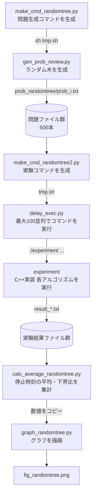
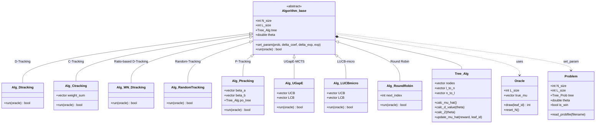
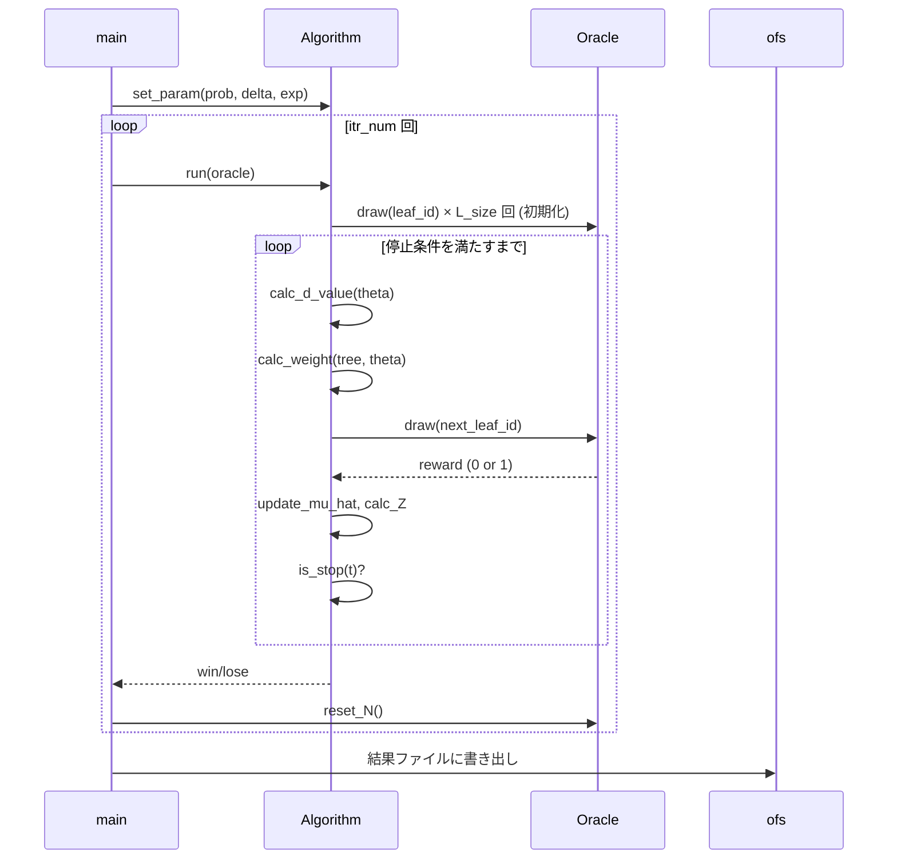

# 閾値MCTSのMPI並列化とその理論的解析

先行研究 "An Efficient Algorithm for Thresholding Monte Carlo Tree Search" (NeurIPS 2026 投稿版) の実装をベースに, RD-Tracking-MCTSをMPIで並列化し, 理論的な性能改善を示すことを目的とするプロジェクト.

## プロジェクト構成

```
parallel-threshold-mcts/
├── src/
│   ├── origin/          # 先行研究の実装 (逐次版)
│   └── test/            # MPI動作確認用デモ
└── docs/
    └── literature/      # 参照論文
```

## 先行研究実装 (`src/origin/`) の実行フロー

### 全体パイプライン



### `experiment.cpp` 内部構造



### 1回の試行における処理の流れ



## 実装済みアルゴリズム一覧 (先行研究)

| アルゴリズム | クラス名 | 概要 |
|---|---|---|
| D-Tracking | `Alg_Dtracking` | 最適重みとの差 $t \cdot w_\ell^* - N_\ell(t)$ が最大の腕を選択 |
| C-Tracking | `Alg_Ctracking` | 重みの累積和を追跡し, 最適配分に近づける |
| Ratio-based D-Tracking | `Alg_WN_Dtracking` | $w_\ell / N_\ell$ が最大の腕を選択 |
| Random-Tracking | `Alg_RandomTracking` | 最適重みに比例した確率でランダムに腕を選択 |
| P-Tracking | `Alg_Ptracking` | Thompson Sampling (Beta分布) で重みを推定 |
| UGapE-MCTS | `Alg_UGapE` | UCB/LCBを再帰的に伝播させ Best/Challenger を比較 |
| LUCB-micro | `Alg_LUCBmicro` | 単調性制約付きUCB/LCBを使用するLUCBの木版 |
| Round Robin | `Alg_RoundRobin` | 全葉ノードを順番に選択するベースライン |

## 停止条件

$$Z_{s_0}(t) \geq \beta(t), \quad \beta(t) = \log\log(t+1) + \log(1/\delta)$$

$Z_{s_0}(t)$ は根ノードの証拠統計量 (KL情報量の木上での集約値).

## 開発目標

- [ ] RD-Tracking-MCTSのMPI並列化実装
- [ ] Virtual Loss によるプロセス分散
- [ ] 並列版と逐次版の停止時刻比較実験
- [ ] 並列化による理論的サンプル複雑性の改善解析
